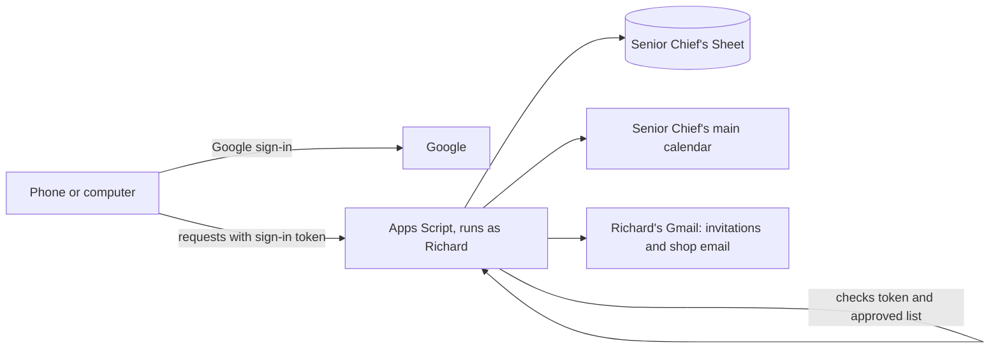

# Building Watch

Facilities scheduling, building watch bill, maintenance log and service requests for the shop.

- **App:** https://richarddemy.github.io/helloWorld/building-watch/ (add `?demo` to try it with sample data)
- **Setup guide:** [SETUP.md](SETUP.md)
- **Onboarding flowcharts:** [onboarding.html](onboarding.html)

## Files

| File | What it is |
|---|---|
| `index.html`, `app.js` | The app people use |
| `config.js` | The two values that connect this copy of the app to Google (script URL and sign-in client ID). Empty means demo mode. |
| `core.js` | Shared app rules: who can do what, watch bill logic, requests, maintenance log |
| `apps-script/Code.gs` | Google Apps Script backend: sign-in check, Sheet storage, calendar, email |
| `apps-script/Core.gs` | Same as `core.js`, for pasting into the script. Keep the two identical. |
| `apps-script/appsscript.json` | Script manifest: permissions, time zone, Calendar service |
| `onboarding.html` | Setup and onboarding flowcharts |

## How it fits together

