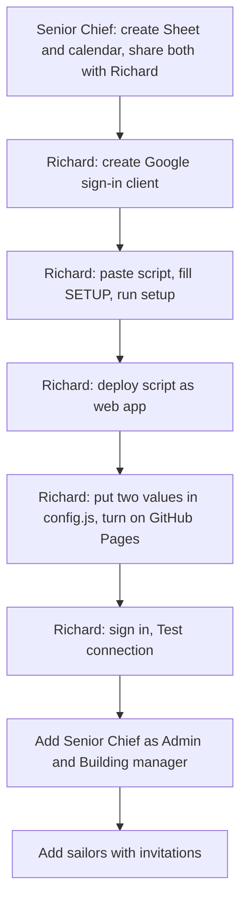
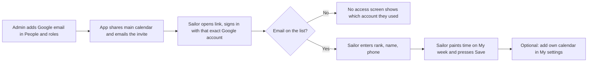
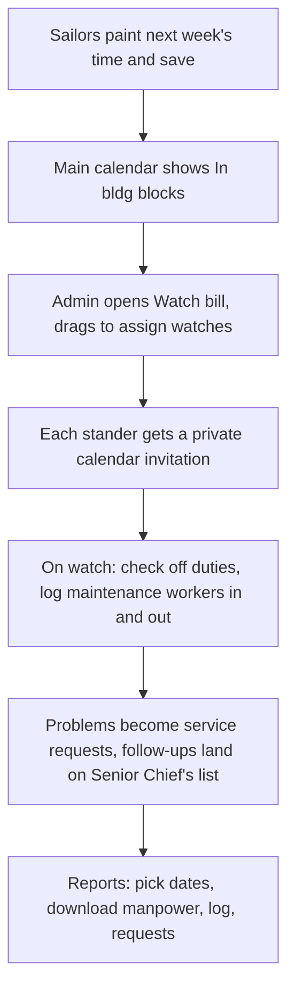

# Building Watch setup

One-time setup takes about 45 minutes. After that, adding a sailor takes 30 seconds.

**Who does what**

| Who | Owns |
|---|---|
| Senior Chief | The data Sheet and the main calendar (both live in his Google Drive and Calendar) |
| MU1 Demy (app owner) | The Apps Script that runs the app, the Google sign-in client, and the GitHub page |
| Admins | Everything inside the app: people, roles, watch bill, settings |

Nobody's Google password ever touches the app. People sign in with Google, and the app only receives their verified email address.



---

## Part 1. Senior Chief (10 minutes)

### 1a. Data Sheet
1. Go to sheets.google.com and create a blank spreadsheet named **Building Watch Data**.
2. Click **Share**, add Richard's Gmail, set to **Editor**, uncheck "Notify" if you like, and click **Share**.
3. Copy the Sheet's address from the browser bar and send it to Richard.

### 1b. Main calendar
1. Go to calendar.google.com. On the left, next to **Other calendars**, click **+**, then **Create new calendar**.
2. Name it **Facilities: In the Building** and click **Create calendar**.
3. Open that calendar's settings. Under **Share with specific people**, add Richard's Gmail with **Make changes and manage sharing**.
4. Scroll to **Integrate calendar** and copy the **Calendar ID** (it ends in `@group.calendar.google.com`). Send it to Richard.

"Manage sharing" lets the app share the calendar automatically with each sailor you add.

---

## Part 2. Richard: Google sign-in client (10 minutes)

This tells Google that the Building Watch page may ask people to sign in.

1. Go to **console.cloud.google.com** and sign in with your Gmail.
2. Create a project named **Building Watch**.
3. Open **Google Auth Platform** (or **APIs & Services, OAuth consent screen**).
   - **Branding:** app name *Building Watch*, your email as support and developer contact.
   - **Audience:** User type **External**, then click **Publish app** so it's **In production**. If you leave it in Testing, only listed test users can sign in. The app only asks for basic sign-in (email and name), so Google doesn't require a review.
4. Open **Clients**, then **Create client**:
   - Application type: **Web application**, name *Building Watch web*.
   - **Authorized JavaScript origins:** add `https://richarddemy.github.io`. Add `https://raw.githack.com` too if you want the preview link to work.
   - Click **Create** and copy the **Client ID** (ends in `.apps.googleusercontent.com`).

---

## Part 3. Richard: the Apps Script (15 minutes)

1. Go to **script.google.com**, click **New project**, and rename it **Building Watch API**.
2. Click the gear (**Project Settings**) and check **Show "appsscript.json" manifest file in editor**.
3. Back in the editor:
   - Open `appsscript.json` and replace everything with the contents of `apps-script/appsscript.json`.
   - Open `Code.gs` and replace everything with `apps-script/Code.gs`.
   - Click **+** next to Files, choose **Script**, name it `Core`, and paste in `apps-script/Core.gs`.
4. At the top of `Code.gs`, fill in `SETUP`:
   - `SHEET`: the Sheet address from step 1a
   - `CALENDAR`: the Calendar ID from step 1b
   - `CLIENT_ID`: the Client ID from Part 2
   - `APP_URL`: leave as is, unless you host it somewhere else
   - `FIRST_ADMIN_NAME`: how your name should show
5. Save, pick **setup** in the function menu, and click **Run**.
6. Approve permissions. Google shows "Google hasn't verified this app." That's expected for your own script: click **Advanced**, then **Go to Building Watch API (unsafe)**, then **Allow**. The script asks for Sheets, Calendar, sending email, and reading web links (for sailors' calendar links).
7. The log should end with "Setup complete." Open the Sheet: it now has tabs for People, Availability, Watches, Requests, Maintenance Log, Audit and Settings.

### Deploy
1. Click **Deploy, New deployment**. Click the gear next to "Select type" and choose **Web app**.
2. **Execute as: Me.** **Who has access: Anyone.** Click **Deploy**.
3. Copy the **Web app URL** (ends in `/exec`).

"Anyone" means the page can reach the script. It doesn't let anyone in: every request must carry a Google sign-in for an approved email, and the script checks that before doing anything.

### Updating the script later
Paste the new code, then **Deploy, Manage deployments**, click the pencil, set **Version: New version**, and **Deploy**. The URL stays the same.

---

## Part 4. Richard: GitHub (5 minutes)

1. In the repo, open `building-watch/config.js`, click the pencil, and fill in:
   ```js
   SCRIPT_URL: "https://script.google.com/macros/s/…/exec",
   GOOGLE_CLIENT_ID: "….apps.googleusercontent.com"
   ```
   Commit the change.
2. Repo **Settings, Pages**: Branch **master**, folder **/ (root)**, **Save**.
3. In a minute or two the app is live at **https://richarddemy.github.io/helloWorld/building-watch/**

The demo still works at that address with `?demo` on the end.

---

## Part 5. First sign-in (5 minutes)

1. Open the app and sign in with your Gmail. You're the first admin.
2. **Admin, Data storage, Test connection.** Confirm it shows the right Sheet, the calendar, and your email.
3. **Admin, People and roles, Add someone:** Senior Chief's Google email, role **Admin**, invitation checked.
4. **Admin, Who's in charge:** set **Building manager** to Senior Chief.
5. Add each sailor the same way, role **Member**.

---

## Adding a sailor



- If a sailor has no Google account, they can make one at accounts.google.com/signup using **Use my current email address instead**, with no new Gmail inbox.
- To remove someone, **Deactivate** them. They're locked out immediately and lose calendar access. History stays in the Sheet.

## The weekly rhythm



---

## Handoff (if Richard transfers)

The data and calendar already live with Senior Chief. A new app owner:
1. Gets the Sheet and calendar shared with them the same way (Part 1).
2. Repeats Parts 2 to 4 under their own account, using the same Sheet address.
3. Updates `config.js` with their new script URL and client ID.
Everything in the Sheet carries over.

## Troubleshooting

| What you see | Fix |
|---|---|
| "You don't have access yet" | The person signed in with a different Google account than the one on the list. The screen shows which one. Fix the email in People and roles, or have them switch accounts. |
| Sign-in button missing or "origin not allowed" | Add the page's address under Authorized JavaScript origins (Part 2, step 4). Changes take a few minutes. |
| "Sign-in is not set up for this app" | `CLIENT_ID` in the script doesn't match `GOOGLE_CLIENT_ID` in config.js. Run setup() again after fixing. |
| "Can't open the data Sheet" | Senior Chief's Sheet is no longer shared with the app owner as Editor. |
| "Couldn't open the main calendar" | Check the Calendar ID in Admin and that the calendar is shared with the app owner. |
| Invitations not arriving at .mil addresses | Government mail often filters outside invitations. Have sailors use their Google email in the app, and see the main calendar on their phone instead. |
| "Daily email limit reached" | Personal Gmail scripts can email about 100 people a day. Try again tomorrow. |
| A sailor's own calendar doesn't show | They need the secret iCal or public .ics link, not the normal calendar page address. Instructions are in My settings. |

## Security notes

- Only emails an admin adds can sign in. The script checks every request, not just the page.
- Members only see their own painted time, plus names on the watch bill. Contact details are visible to admins only.
- Sailors' own calendar titles are shown only to that sailor.
- Keep the data to names, Google emails, phone numbers, times and building issues. Nothing more sensitive belongs here.
- The code on GitHub is public. It contains no names or data. Real data lives only in the Sheet.
